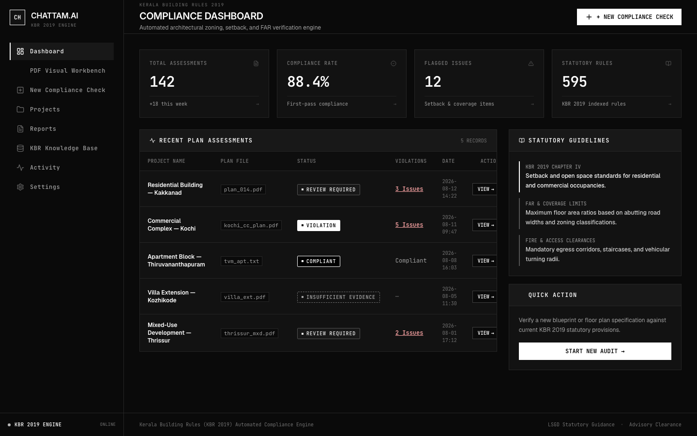
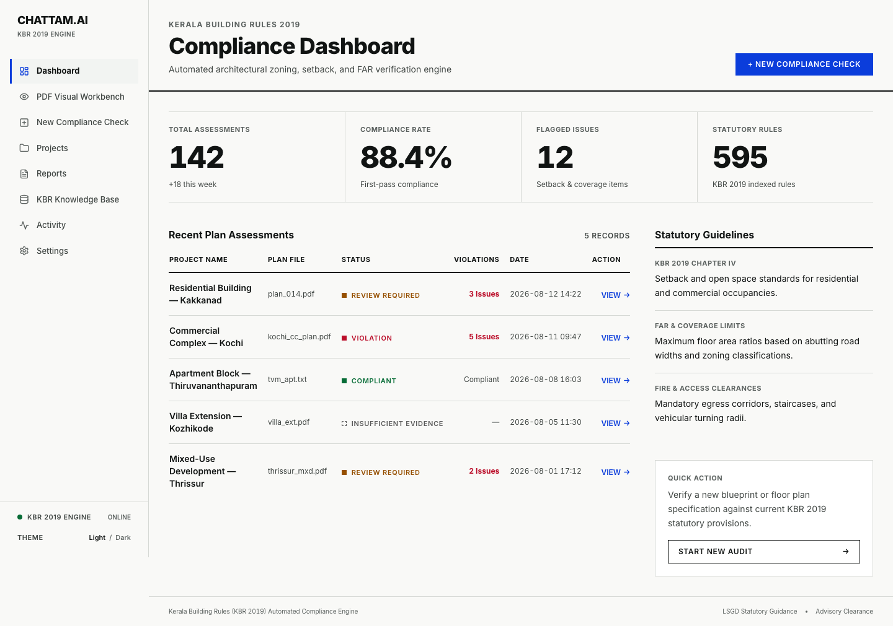
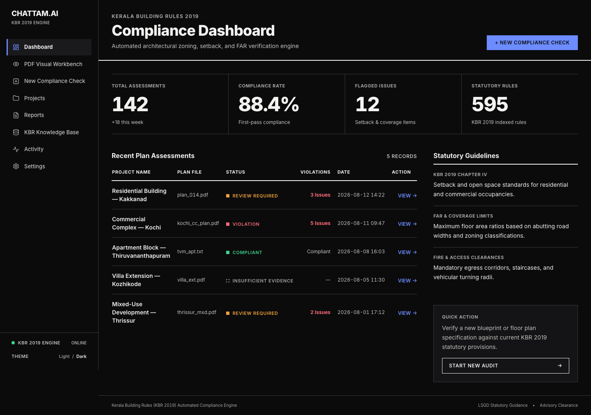
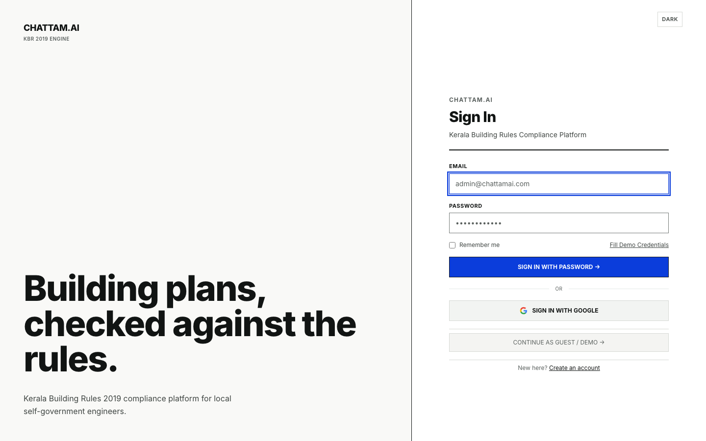
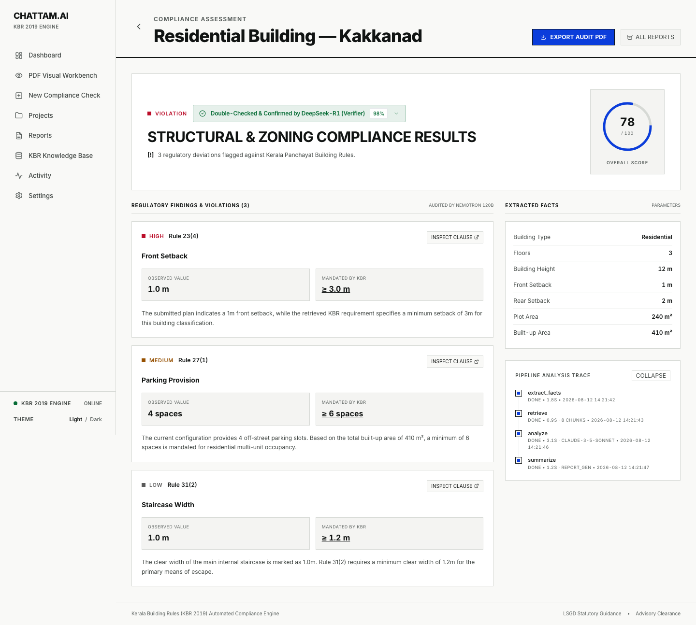
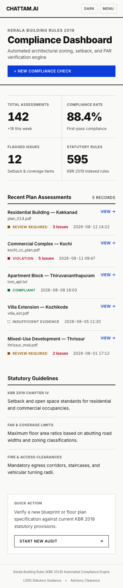
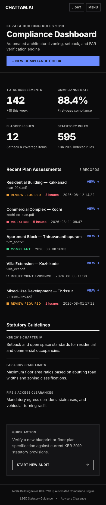

# Swiss Modernism 2.0 redesign

The web app was redesigned in the International Typographic Style (updated): a strict
grid, one grotesque sans (Inter), hairline rules instead of boxes, no shadows, and one
accent colour. It has a **light** theme (default) and an optional **dark** theme.

Designed with Stitch (project `3113204283404970651`, design system `ChattamAI Swiss 2.0`),
then implemented in React + Tailwind. Behaviour, routes, copy and API calls are unchanged.

| Before | After (light) | After (dark) |
| --- | --- | --- |
|  |  |  |

| Sign in | Result | Mobile (light) | Mobile (dark) |
| --- | --- | --- | --- |
|  |  |  |  |

## Principles

- **Grid first.** 240px rail + 12-column content grid, 24px gutters, 8px baseline.
- **Type is the interface.** Inter only; hierarchy by size and weight; uppercase tracked
  labels; tabular figures for every number. No monospace UI type.
- **Whitespace and rules, not boxes.** Hairlines separate; a 2px ink rule closes each page
  header and table header. No shadows, gradients or decorative imagery.
- **Colour is rare and meaningful.** Accent (blue) is for actions, links, focus and the
  active nav item only. Status colours are for compliance results only and always come with
  a label and a shape glyph (never colour alone): Compliant, Review required, Violation,
  Insufficient evidence (dashed).

## Tokens (`frontend/src/index.css`, `tailwind.config.js`)

Colours are CSS variables holding RGB triplets (`--c-*`), exposed as Tailwind colours
(`bg-surface`, `text-ink-2`, `border-line`, `text-danger`, `bg-accent`...), so every utility
supports opacity and a theme switch only changes variables.

| Token | Light | Dark |
| --- | --- | --- |
| `bg` / `surface` | #F9F9F7 / #FFFFFF | #0B0B0C / #141416 |
| `ink` / `ink-2` / `ink-3` | #111413 / #3F4542 / #5A605E | #F2F2F0 / #C4C4C0 / #A8A8A8 |
| `accent` / `on-accent` | #0B3DDB / #FFFFFF | #6C8CFF / #0B0B0C |
| `ok` / `warn` / `danger` | #076C36 / #965000 / #BB0D29 | #3DD68C / #F2A33A / #FF6B7A |

Status colours in the light theme are a little darker than the Stitch spec so that text on
tinted and grey surfaces still reaches 4.5:1; `src/test/designSystem.test.js` enforces this.

## Theme

`index.html` applies the saved choice (or the system preference, else light) before first
paint. `src/theme.js` keeps it in sync and persists it under `chattam.theme`; the toggle is
in the rail footer (and the mobile bar and sign-in/up screens).

## Decisions

- Stitch's screens are used as layout references only. Stitch added things this app does
  not have (a top bar with "Statutory Circulars", notifications, "Forgot password?", a
  statutory citation, an "audit hash" badge); none of that was implemented.
- Dashboard shows a stacked list instead of a table on phones (a wide table clipped the
  status column), and the old clipped "Action" column on desktop is fixed.
- Fixed along the way: the Workbench nav item had no icon (`eye` was missing from the icon
  set); scrollable tables are now keyboard-focusable; unlabeled Settings inputs are labelled;
  pending steps on the Analysis page no longer rely on opacity (which broke contrast).

## Verification

- 124 unit/component tests (67 before). New: theme logic, shell/nav/header/pill/auth layout,
  and two design-system guards (no hard-coded colours; computed WCAG contrast of every token
  pair in both themes).
- Browser audit (`frontend/scripts/ui-audit`), 13 routes x desktop/mobile x light/dark = 52 pages:
  0 console errors, 0 horizontal overflow, 0 axe A/AA violations (baseline: 318 nodes, mostly
  colour contrast), and no control from the old UI missing (headings 62=62, inputs 28=28;
  only the theme switch and skip link were added).
